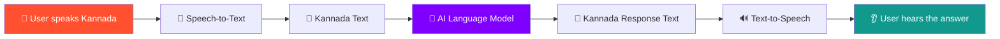
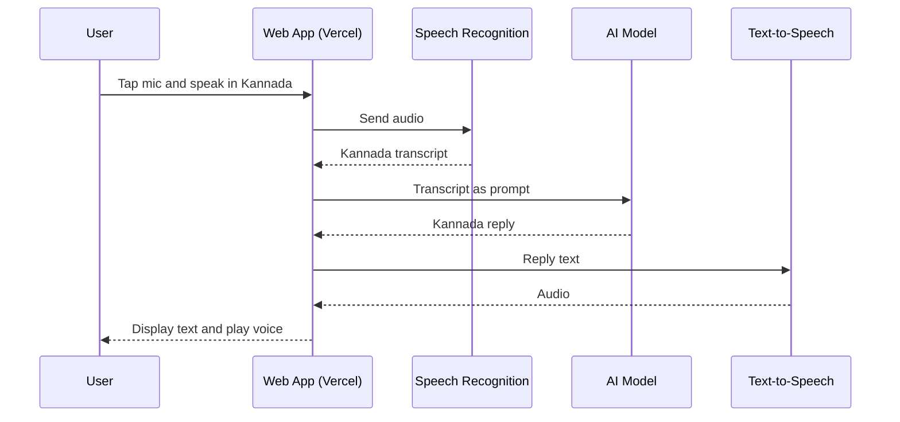

<div align="center">


# 🎙️ VoiceKannada-AI

### ಕನ್ನಡದಲ್ಲಿ ಮಾತನಾಡಿ — AI ಉತ್ತರಿಸುತ್ತದೆ
**A Kannada-first voice assistant that listens, understands, and speaks back.**

<p>
  <a href="https://voice-kannada.vercel.app/"></a>
  <a href="https://github.com/sathi2305/VoiceKannada-AI"></a>
</p>

<p>
  
  
  
  
  
  
  
</p>

**[🌐 Live Demo](https://voice-kannada.vercel.app/)** •
**[✨ Features](#-features)** •
**[🏗️ Architecture](#️-architecture)** •
**[⚙️ Installation](#️-installation)** •
**[🚀 Deployment](#-deployment)** •
**[🤝 Contributing](#-contributing)**

</div>

---

## 📖 Table of Contents

- [About the Project](#-about-the-project)
- [Live Demo](#-live-demo)
- [Screenshots](#-screenshots)
- [Features](#-features)
- [Architecture](#️-architecture)
- [Tech Stack](#-tech-stack)
- [Project Structure](#-project-structure)
- [Installation](#️-installation)
- [Environment Variables](#-environment-variables)
- [Usage](#-usage)
- [Deployment](#-deployment)
- [Roadmap](#️-roadmap)
- [Troubleshooting](#-troubleshooting)
- [Contributing](#-contributing)
- [License](#-license)
- [Contact](#-contact)

---

## 🌟 About the Project

**VoiceKannada-AI** brings conversational AI to the Kannada language. Most voice assistants treat Indian languages as an afterthought. This project puts **Kannada first**, so anyone can talk to an AI in their own language, without typing and without needing English.

**The idea in one line:** you speak in Kannada, the app converts your speech to text, an AI model understands and answers, and the answer is spoken back to you in Kannada.

### 🎯 Why this project?

| Problem | How VoiceKannada-AI helps |
|---|---|
| Most AI tools are English-centric | Kannada-first voice experience |
| Typing in Kannada is slow for many users | Speak naturally instead |
| Low-literacy and elderly users struggle with text UIs | Voice-in, voice-out interaction |
| Hard to access AI in regional languages | Free, browser-based, no install needed |

---

## 🚀 Live Demo

<div align="center">

### 👉 **[https://voice-kannada.vercel.app/](https://voice-kannada.vercel.app/)** 👈

*Open in Chrome or Edge on desktop or mobile, and allow microphone access when asked.*

</div>

---

## 📸 Screenshots

> 💡 **Add your own images:** save screenshots in `docs/screenshots/` using the file names below and they will appear here automatically.

<div align="center">

| Home Screen | Voice Listening |
|:---:|:---:|
|  |  |
| **Landing page with mic button** | **Live Kannada speech capture** |

| AI Response | Mobile View |
|:---:|:---:|
|  |  |
| **Text + spoken Kannada answer** | **Fully responsive layout** |

</div>

### 🎬 Demo GIF

<div align="center">
  
</div>

---

## ✨ Features

- 🎤 **Kannada speech recognition**: speak naturally and see your words transcribed.
- 🧠 **AI-powered responses**: a language model understands your question and replies.
- 🔊 **Spoken replies**: answers are read aloud in Kannada through text-to-speech.
- 💬 **Conversation view**: see the transcript of what you said and what the AI answered.
- 📱 **Responsive design**: works on phones, tablets, and desktops.
- ⚡ **Fast and lightweight**: served from Vercel's global edge network.
- 🌐 **No installation for users**: runs fully in the browser.
- 🔓 **Open source**: free to read, fork, and improve.

---

## 🏗️ Architecture



### Request lifecycle



---

## 🧰 Tech Stack

<div align="center">


</div>

| Layer | Technology |
|---|---|
| **Frontend** | HTML, CSS, JavaScript (update to match your framework) |
| **Speech input** | Browser Web Speech API / ASR service for `kn-IN` |
| **AI engine** | Large Language Model API |
| **Speech output** | Text-to-Speech for Kannada |
| **Hosting** | Vercel |
| **Version control** | Git and GitHub |

> ✏️ **Note:** edit this table so it matches the exact libraries and APIs used in your code.

---

## 📂 Project Structure

```text
VoiceKannada-AI/
├── docs/
│   └── screenshots/        # README images and demo GIF
├── public/                 # Static assets
├── src/                    # Application source code
├── .env.example            # Sample environment variables
├── package.json            # Dependencies and scripts
├── README.md               # You are here
└── LICENSE
```

> ✏️ Adjust the tree to reflect your real folder layout.

---

## ⚙️ Installation

### Prerequisites

- [Node.js](https://nodejs.org/) v18 or newer
- npm or yarn
- A modern browser (Chrome or Edge recommended for voice features)
- A microphone

### 1️⃣ Clone the repository

```bash
git clone https://github.com/sathi2305/VoiceKannada-AI.git
cd VoiceKannada-AI
```

### 2️⃣ Install dependencies

```bash
npm install
```

### 3️⃣ Set up environment variables

```bash
cp .env.example .env
```

Then open `.env` and add your keys (see the [next section](#-environment-variables)).

### 4️⃣ Run locally

```bash
npm run dev
```

Open **http://localhost:3000** (or the port shown in your terminal).

### 5️⃣ Build for production

```bash
npm run build
npm start
```

---

## 🔐 Environment Variables

Create a `.env` file in the project root:

```env
# AI model API key
API_KEY=your_api_key_here

# Optional: model name or endpoint
MODEL_NAME=your_model_name

# Optional: default language for speech
SPEECH_LANG=kn-IN
```

> ⚠️ **Never commit your `.env` file.** Make sure `.env` is listed in `.gitignore`.

---

## 🎮 Usage

1. 🌐 Open **[voice-kannada.vercel.app](https://voice-kannada.vercel.app/)**.
2. 🎤 Tap the **microphone** button and **allow microphone access**.
3. 🗣️ Speak your question in **Kannada**, for example:
   - *"ಇಂದಿನ ಹವಾಮಾನ ಹೇಗಿದೆ?"* (How is the weather today?)
   - *"ಕರ್ನಾಟಕದ ರಾಜಧಾನಿ ಯಾವುದು?"* (What is the capital of Karnataka?)
   - *"ನನಗೆ ಒಂದು ಕಥೆ ಹೇಳು"* (Tell me a story)
4. ⏳ Wait a moment while the AI processes your request.
5. 🔊 Read the answer on screen and **listen to it spoken** in Kannada.

### 💡 Tips for best results

- Speak clearly and at a normal pace.
- Use a quiet environment or a headset mic.
- Use **Chrome** or **Edge** for the best speech recognition support.

---

## 🚀 Deployment

This project is deployed on **Vercel**:

🔗 **Production URL:** https://voice-kannada.vercel.app/

### Deploy your own copy in one click

[](https://vercel.com/new/clone?repository-url=https://github.com/sathi2305/VoiceKannada-AI)

### Manual deployment steps

1. Push your code to GitHub.
2. Go to [vercel.com](https://vercel.com) and click **Add New → Project**.
3. Import the **VoiceKannada-AI** repository.
4. Add your **environment variables** under *Settings → Environment Variables*.
5. Click **Deploy**.

Every push to the `main` branch triggers an automatic redeploy. 🎉

### Using the Vercel CLI

```bash
npm install -g vercel
vercel login
vercel          # preview deployment
vercel --prod   # production deployment
```

---

## 🗺️ Roadmap

- [x] Kannada speech input
- [x] AI-generated responses
- [x] Kannada voice output
- [x] Vercel deployment
- [ ] Conversation history and memory
- [ ] Support for more Indian languages (Hindi, Tamil, Telugu)
- [ ] Offline mode
- [ ] Voice selection (male / female)
- [ ] Dark mode
- [ ] Progressive Web App (installable on phones)
- [ ] Accessibility improvements for visually impaired users

Have an idea? [Open an issue](https://github.com/sathi2305/VoiceKannada-AI/issues) 💡

---

## 🛠️ Troubleshooting

| Issue | Solution |
|---|---|
| Mic not working | Allow microphone permission in the browser's site settings |
| No voice output | Check the device volume and that a Kannada voice is installed |
| Speech not recognised | Use Chrome or Edge, and speak clearly in a quiet place |
| App not loading | Hard refresh with `Ctrl + Shift + R` |
| API errors | Verify your `.env` keys and your API quota |

---

## 🤝 Contributing

Contributions make open source great! Here is how to help:

1. 🍴 **Fork** the repository
2. 🌿 **Create** a feature branch
   ```bash
   git checkout -b feature/amazing-feature
   ```
3. 💾 **Commit** your changes
   ```bash
   git commit -m "Add amazing feature"
   ```
4. 📤 **Push** to your branch
   ```bash
   git push origin feature/amazing-feature
   ```
5. 🔁 **Open a Pull Request**

### Contribution ideas

- Improve Kannada recognition accuracy
- Add new languages
- Improve UI and accessibility
- Write tests and documentation

---

## 📜 License

Distributed under the **MIT License**. See [`LICENSE`](LICENSE) for details.

---

## 📬 Contact

**Sathi** · GitHub: [@sathi2305](https://github.com/sathi2305)

🔗 **Project Link:** [https://github.com/sathi2305/VoiceKannada-AI](https://github.com/sathi2305/VoiceKannada-AI)
🌐 **Live App:** [https://voice-kannada.vercel.app/](https://voice-kannada.vercel.app/)

---

<div align="center">

### ⭐ If you like this project, please give it a star! ⭐

**Made with ❤️ for the Kannada community — ಕನ್ನಡಕ್ಕಾಗಿ ❤️**


</div>
