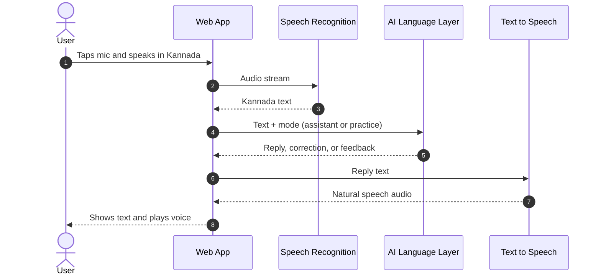
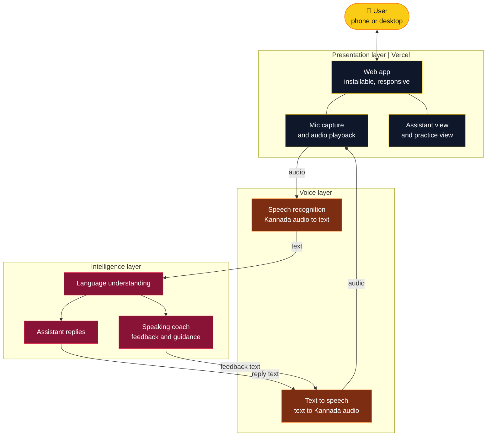
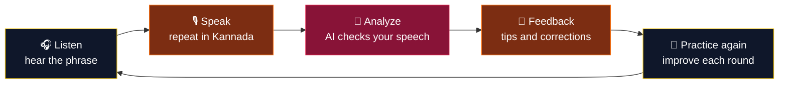

<div align="center">


<a href="https://voice-kannada.vercel.app/">
  
</a>

<br/>

[](https://voice-kannada.vercel.app/)
[](https://voice-kannada.vercel.app/)
[](https://voice-kannada.vercel.app/)


<br/>

**[Live Demo](https://voice-kannada.vercel.app/)** &nbsp;|&nbsp; **[Overview](#-overview)** &nbsp;|&nbsp; **[Features](#-features)** &nbsp;|&nbsp; **[Architecture](#-architecture)** &nbsp;|&nbsp; **[Quick Start](#-quick-start)** &nbsp;|&nbsp; **[Roadmap](#-roadmap)**

</div>

<br/>

---

<div align="center">

## 🎯 Overview

**ಕನ್ನಡ ಧ್ವನಿ: a voice-first way to use and learn Kannada.**

VoiceKannada AI is a web-based voice assistant and immersive language learning platform. Speak in Kannada, get it recognized, hear natural replies, and practice speaking with instant AI feedback, all from your browser or phone.

<br/>

| 😕 The problem | ✅ VoiceKannada AI |
|:---|:---|
| Most voice tools are built for English first | Built around Kannada from the start |
| Typing Kannada is slow and awkward on many devices | Just speak, and the app listens |
| Learners get no feedback on how they sound | Speaking practice with AI guidance |
| Learning apps feel like flashcards | Immersive, conversation-style practice |
| Apps need installs and setup | Open the link and start, or add it to your home screen |

</div>

<br/>

---

<div align="center">

## ✨ Features

</div>

<table align="center">
<tr>
<td width="50%" valign="top">

### 🎙️ Voice Assistant
- Speech recognition for spoken Kannada
- Natural text-to-speech replies you can hear
- Hands-free, conversation-style interaction
- Clean, dark, distraction-free interface

</td>
<td width="50%" valign="top">

### 📚 Language Learning
- Immersive learning experience
- Speaking practice with AI feedback
- Listen, repeat, and improve loop
- Built for learners and native speakers alike

</td>
</tr>
<tr>
<td width="50%" valign="top">

### 📱 Works Everywhere
- Responsive on phone, tablet, and desktop
- Installable as a web app on mobile
- No sign-up wall, open and use

</td>
<td width="50%" valign="top">

### ⚡ Fast and Modern
- Deployed on Vercel's global edge network
- Smooth, animated interface
- Optimized for quick voice round trips

</td>
</tr>
</table>

<br/>

---

<div align="center">

## 🔄 How It Works

</div>



<br/>

---

<div align="center">

## 🏗️ Architecture

</div>



<br/>

<div align="center">

| Layer | Responsibility |
|:---|:---|
| **Presentation** | Responsive, installable web app that handles the mic, playback, and both assistant and practice views |
| **Voice** | Converts spoken Kannada to text and reply text back into natural speech |
| **Intelligence** | Understands the request, produces replies, and coaches speaking practice |
| **Hosting** | Vercel deployment with automatic builds from GitHub |

</div>

<br/>

### 🎓 Learning loop



<br/>

---

<div align="center">

## 🧰 Tech Stack


</div>

<br/>

| | |
|:---|:---|
| **Frontend** | Responsive, installable web app |
| **Voice** | Speech recognition and text-to-speech for Kannada |
| **AI** | Language understanding and speaking feedback |
| **Hosting** | Vercel, deployed from GitHub |

<br/>

---

## 🚀 Quick Start

### Use it online

Open **[voice-kannada.vercel.app](https://voice-kannada.vercel.app/)**, allow microphone access, and start speaking. On a phone, use your browser's **Add to Home Screen** to install it like an app.

### Run it locally

```bash
git clone https://github.com/sathi2305/VoiceKannada-AI.git
cd VoiceKannada-AI
npm install
npm run dev
```

Then open the local address shown in your terminal.

> **Tip:** microphone access works on `localhost` and on HTTPS sites. Use a recent Chrome or Edge for the best speech support.

<br/>

---

## ☁️ Deployment

| | |
|:---|:---|
| **Live site** | [voice-kannada.vercel.app](https://voice-kannada.vercel.app/) |
| **Host** | Vercel |
| **Flow** | Push to GitHub, Vercel builds and publishes automatically |

<br/>

---

## 🗓️ Roadmap

- [x] Kannada speech recognition
- [x] Natural text-to-speech replies
- [x] Speaking practice mode
- [x] Mobile-friendly, installable experience
- [ ] Progress tracking and streaks
- [ ] More regional accents and dialects
- [ ] Offline practice mode
- [ ] More Indian languages

<br/>

---

## 🤝 Contributing

Contributions are welcome.

1. Fork the repository
2. Create a branch: `git checkout -b feature/your-feature`
3. Commit your changes: `git commit -m "Add your feature"`
4. Push the branch: `git push origin feature/your-feature`
5. Open a pull request

<br/>

---

<div align="center">

### Built by [Sathiyamoorthi S](https://github.com/sathi2305)

If VoiceKannada AI helped you, consider giving it a ⭐

[](https://voice-kannada.vercel.app/)


</div>
